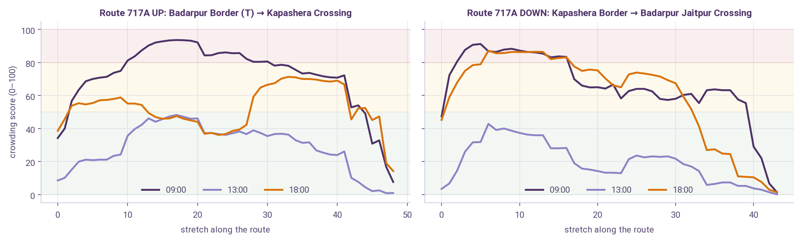

# SeatSense — a crowding-aware bus journey planner for Delhi

**Transport Stack Hackathon 2026 · Problem 2 (Crowdedness-aware journey planner) · Phase 1 submission**

**Team:** c0d3l0v3r · **Code:** [github.com/c0d3l0v3r-HeHe/seatsense](https://github.com/c0d3l0v3r-HeHe/seatsense)

Journey planners rank trips by time and changes, but a packed bus is a different trip. SeatSense turns one month of
Delhi bus e-tickets into **how crowded each bus usually is, on every stretch between stops, hour by hour**, and shows
that next to every journey option so a commuter can trade a few minutes for a seat. Operators get the flip side: the
crowded stretches that carry the most riders, i.e. where an extra bus helps most people.

| | |
|---|---|
| Data | 2.56 M bus e-tickets, 1–31 Oct 2026 (Transport Stack) |
| Network recovered | 1,091 route-directions, 4,724 stop names grouped into 3,384 places |
| Crowding estimates | 1.83 M (route × stretch × hour × weekday / Saturday / Sunday), each with a confidence flag |
| Checked against an unseen week | same crowding level as reality on **92 %** of stretch-hours, correlation **0.96** |
| Demo | Flutter app (web, Linux desktop; Android/iOS from the same code) + FastAPI backend |



## How it works (one paragraph)

Every e-ticket says *where a rider got on, where they planned to get off, and when*. Tickets bought minutes apart on
the **same bus** give the order of stops and the travel time between them (a least-squares fit over 507 k ticket
pairs), so the network is rebuilt from the tickets alone. Each rider is then counted on every stretch between their two
stops, in the hour they travelled, and averaged over the month for weekdays, Saturdays and Sundays. Dividing by the
number of buses seen on the route (from vehicle numbers) gives riders per bus; a rider-weighted percentile turns that
into a 0–100 score and three levels — **Seats likely / Standing room / Crowded**. The planner searches direct and
one-change journeys and ranks them by `minutes + λ × (minutes standing × 0.3 + minutes crowded)`, where λ comes from
the user's choice (fastest, balanced, a seat). Full method: [docs/technical_note.md](docs/technical_note.md).

We also built and tested the alternative — a **station graph + LightGBM** model that predicts boardings and alightings
at every stop and rebuilds who-rides-where with a gravity/IPF model. On routes with tickets it was no better than direct
counting (30.8 % vs 29.8 % error); it only helps for routes with no tickets. See
[notebooks/02_crowding_approaches.ipynb](notebooks/02_crowding_approaches.ipynb).

**No LLM is used.** Every number traces back to tickets; the method is deterministic and reruns in ~45 s.

## Quick start

Requirements: Python ≥ 3.11 with `pandas pyarrow numpy scipy matplotlib fastapi uvicorn` (and `lightgbm networkx` for
notebook 02); Flutter ≥ 3.22 for the app. Put `October-Delhi.csv.zip` (from the
[hackathon data page](https://delhi.transportstack.in/hackathon/)) in the repo root.

```bash
pip install -r requirements.txt
scripts/build_all.sh October-Delhi.csv.zip   # crowding tables, validation, figures, Flutter web build
scripts/run_api.sh                           # API + web app on http://localhost:8000  (API docs: /docs)
```

Step by step:

```bash
export PYTHONPATH=src
python -m crowding.pipeline --raw October-Delhi.csv.zip   # -> outputs/crowding/*.parquet, *.csv(.gz), meta.json
python -m crowding.validate                               # -> outputs/validation.json, outputs/figures/*.png
cd app && flutter run -d chrome                           # or: flutter run -d linux / an Android device
```

Demo deep links (web): `http://localhost:8000/?from=Badarpur%20Border%20(T)&to=Saket%20Metro%20Station&time=08:30`,
`/?tab=routes`, `/?tab=hotspots`. A 3-minute demo script is in [docs/demo_script.md](docs/demo_script.md).

## Run it without the raw data (Docker / hosting)

The crowding tables in `outputs/crowding/` are committed, so the API and web app run without the ticket file. The
[`Dockerfile`](Dockerfile) installs only the serving dependencies, pulls the pre-built Flutter web app from the
[v1.0-phase1 release](https://github.com/c0d3l0v3r-HeHe/seatsense/releases/tag/v1.0-phase1), and listens on `$PORT`.
It runs within a free hosting tier (512 MB RAM, 0.1 CPU): about 370 MB in use, ready in ~25 s, a plan in under 0.5 s.

```bash
docker build -t seatsense . && docker run -p 8000:8000 seatsense   # http://localhost:8000
```

One-click hosting on Render's free plan uses [`render.yaml`](render.yaml):
[Deploy to Render](https://render.com/deploy?repo=https://github.com/c0d3l0v3r-HeHe/seatsense). A free service sleeps
after 15 idle minutes, so the first visit after a pause takes a minute or two to load.

## Outputs (queryable)

| File | What |
|---|---|
| `outputs/crowding/segment_crowding.parquet` / `.csv.gz` | one row per route-direction × stretch × hour × day type: e-ticket riders, riders-per-bus index, score 0–100, level, confidence |
| `outputs/crowding/route_stops.parquet` | stop sequence of every route-direction with minutes-along-route and ticket evidence per stretch |
| `outputs/crowding/routes.parquet` / `.csv` | route summary: terminals, buses seen, estimated headway, end-to-end time, AC share |
| `outputs/crowding/stops.parquet` | stops with their place group and monthly boardings |
| `outputs/validation.json`, `outputs/figures/` | checks against known patterns and the held-out week |

API (`python -m crowding.api`): `/api/stops?q=`, `/api/plan?from=&to=&day=&time=&pref=`, `/api/route/{route}`,
`/api/routes`, `/api/hotspots?day=&hour=`, `/api/meta`, `/api/validation`. Interactive docs at `/docs`.

## Repository

```
src/crowding/      pipeline (ingest, stops, data, pipeline, validate), planner, API, approach B (graph + ML)
app/               Flutter app: Plan · Routes · Hotspots · How it works
notebooks/         01 data exploration · 02 approach A vs B comparison
docs/              technical note, Phase 1 proposal, demo script
Dockerfile, render.yaml   container for the API + web app, and a Render blueprint
outputs/           generated tables, figures, screenshots (rebuild with scripts/build_all.sh)
```

## Limits (read before quoting numbers)

- E-tickets are roughly **1–3 % of riders** (no cash/ETM paper tickets, passes or free pink tickets), so levels are
  **relative** (riders per bus compared across the network), not head counts.
- No GTFS yet: stops, order and travel times come from the tickets, so there is **no map** and travel times are
  estimates. A few routes carry mis-tagged tickets that can create an implausible short hop; GTFS removes this.
- Planned alighting stop is used as the actual one. Holidays (2 and 20 Oct) are excluded.

Details and where estimates are least reliable: [docs/technical_note.md](docs/technical_note.md#where-the-estimates-are-least-reliable).

## License

MIT — see [LICENSE](LICENSE). Data © its providers (Transport Stack / IIIT-Delhi), not redistributed here.
