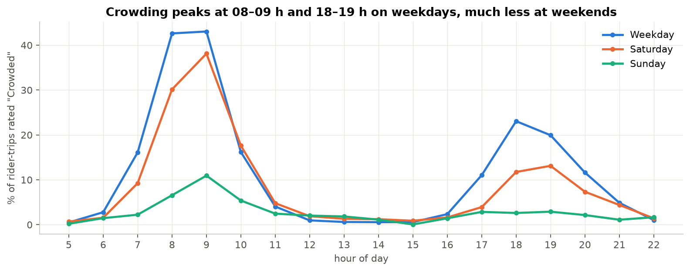

# SeatSense — technical note

*Transport Stack Hackathon 2026 · Problem 2: Crowdedness-aware journey planner · Phase 1 · code: [github.com/c0d3l0v3r-HeHe/seatsense](https://github.com/c0d3l0v3r-HeHe/seatsense)*

## 1. Summary

We estimate how crowded Delhi buses usually are **by route, direction, stretch between stops, hour and day type**
from 2.56 M e-tickets (1–31 Oct 2026), and show it next to each option in a journey planner. The method is direct
counting: every ticket puts one rider on every stretch between their boarding and planned alighting stop. Because the
data has no stop IDs or schedules, the route network (stop order, travel times) is recovered from the tickets
themselves. Estimates are relative (riders per bus compared across the network), carry a confidence flag, and match
the crowding level of an unseen week on 92 % of stretch-hours.

## 2. Data

| Item | Detail |
|---|---|
| Records | 2,559,899 tickets, 2,753,606 passengers, every day 1–31 Oct 2026 |
| Fields | passenger_count, amount, vehicle_number, ticket_type_id, start/end stop name, route (e.g. `717AUP`), created_at (IST), is_ac |
| Quality | no missing times/routes/stops, no duplicates; `ticket_type_id` is constant; vehicle number missing on 48.5 % (spread evenly across routes) |
| Stop names | free text, many spellings per place (e.g. five for Saket Metro Station) |

**Key finding:** every fare is 90 % of a standard DTC slab (₹4.5/9/13.5 non-AC, ₹9/13.5/18/22.5 AC) — the digital
ticket discount. The file is the **digital e-ticket stream only**, not conductor ETM tickets. A median bus-day shows
~12 e-ticket riders, so e-tickets are roughly **1–3 % of riders**. Cash buyers, pass holders and women on free pink
tickets are absent. We therefore estimate *relative* crowding, not head counts.

Patterns are strong and stable: weekdays average 102 k e-ticket riders, Saturdays 81 k, Sundays 50 k; boardings peak
at 09:00 and 18:00; route × stretch × hour profiles correlate at ≥ 0.91 between any two weeks.

## 3. Method

### 3.1 Recovering the network from tickets

1. **Stop order and travel time from same-bus timing.** Consecutive tickets bought on the same vehicle and route
   within 45 min give "stop B is Δt minutes after stop A". For each route-direction we solve a weighted least-squares
   problem for each stop's minutes-along-route τ (507,189 ticket pairs; damped LSQR on the largest linked group of
   stops). Sorting by τ gives the stop order; differences of τ give stretch travel times. Used for **941** of 1,091
   route-directions; 99.4 % (median) of riders' boarding stop then comes before their alighting stop.
2. **Fallback for thin routes (150).** Pairwise votes ("boarded at a, going to b" means a before b), Copeland
   ranking plus adjacent-swap polishing; τ = position × the route's median minutes per stop.
3. **Noise control.** Stops seen < max(8, 0.2 % of the route's tickets) are dropped; the planner only uses stretches
   that at least max(10, 3 % of median) tickets actually ride across.
4. **Places.** Stop-name variants are grouped into 3,384 places by shared distinctive name parts, word order and
   near-identical spellings (never across different numbers, never via road names).
5. **Time of day.** Observed vs typical stop-to-stop times give an hourly factor: 0.8× before 07:00, 1.25× at
   18:00–19:00 (evening traffic).

### 3.2 Counting riders on board

For each day type (weekday, Saturday, Sunday; holidays 2 and 20 Oct excluded) and each boarding hour 05–22, every
ticket adds `passenger_count` to every stretch from its boarding stop to its planned alighting stop (a running count:
boardings minus alightings along the route). Sums are divided by the number of days → **e-ticket riders on that
stretch per day in that hour**. Stretch-hours with < 10 tickets are smoothed over ±1 hour.

### 3.3 From riders to a crowding level

- **Riders per bus.** Divide by the number of distinct buses seen on the route that day type (from vehicle numbers;
  floor 2). This accounts for frequency: busy routes have more buses (fleet and demand correlate at 0.91).
- **Score 0–100** = share of weekday rider-trips on less crowded stretch-hours (rider-weighted percentile).
- **Levels:** < 50 **Seats likely**, 50–80 **Standing room**, ≥ 80 **Crowded** (by construction 50 / 30 / 20 % of
  weekday rider-trips). Weekend values use the weekday thresholds, so weekends read lighter.
- **Confidence** from tickets behind each estimate: ≥ 30 high, 10–29 medium, < 10 low. High-confidence cells are 27 %
  of weekday cells but carry **79 %** of riders; low-confidence cells carry 1.5 %.

### 3.4 Journey planner

- Search: all direct and one-change journeys between two places (change within a place: 2 min if same stop, 5 min
  walk to a nearby stop). Wait = half the estimated headway (round-trip time ÷ buses seen, 2–15 min).
- Each stretch gets the crowding of the hour the bus is expected to be there.
- Ranking: `cost = minutes + λ × (minutes standing × 0.3 + minutes crowded × 1.0)`, λ = 0 (fastest), 0.6
  (balanced), 2.0 (a seat). Low-confidence stretches count as standing, so thin routes are never sold as empty.
- Each option shows total time, crowding level, minutes crowded, the worst stretch, confidence, and whether leaving
  15 or 30 min later is calmer.

## 4. Alternative tested: station graph + ML

Station graph (4,951 stations, consecutive stops linked), features per stop/hour (position, degree, PageRank,
betweenness, place type, demand at the same station on other routes, own history), two LightGBM Poisson models for
boardings and alightings, a gravity model balanced by IPF to rebuild origin–destination flows, then the running count.
Trained by cross-fitting over days; tested on the same unseen week.

| Test (26–30 Oct) | Direct counting | Graph + ML |
|---|---|---|
| Routes with tickets: error (WMAPE) | **29.8 %** | 30.8 % |
| Routes with tickets: busiest 10 % found | **83.8 %** | 83.5 % |
| Routes hidden from the model: error | (no estimate possible) | 77.6 % (naive average 105 %) |
| Routes hidden from the model: busiest 10 % found | – | 50.5 % (naive 32.2 %) |

The OD rebuild is lossless given true boardings/alightings (0.05 % error), so all of B's error is in predicting them —
which counting measures directly. **Decision:** counting is the engine; the graph model is kept for routes without
tickets once GTFS adds them. (Comparison run with the vote-based stop order; see notebook 02.)

## 5. Validation and checks against known patterns

| Check | Result |
|---|---|
| Learn 5–23 Oct weekdays, predict 26–30 Oct | same level on **92.3 %** of 611,658 stretch-hours; correlation 0.956; bias −0.2 %; busiest 10 % found 74.4 %; error 34 % |
| Week-to-week stability | stretch × hour profiles correlate ≥ 0.91 between every pair of weeks |
| Morning and evening peaks | share of weekday rider-trips rated Crowded: 43 % at 08–09 h, 23 % at 18 h, 1 % midday |
| Weekday vs weekend | mean score 08–10 h: weekday 70, Saturday 65, Sunday 43 |
| Commute direction flips | Asian Market → Saket Crossing (525STL) is the top crowded stretch at 09:00, the reverse direction at 18:00; same for Janakpuri ↔ Lajwanti Garden (778) |
| Busy corridors | Badarpur–Saket–Mehrauli (717A/B, 525STL, 433), Okhla (8, 511A), Janakpuri (778) dominate both peaks |



## 6. Assumptions

1. E-ticket riders are spread across buses, stretches and hours like all riders (so relative crowding holds).
2. Riders get off at the stop on their ticket.
3. Buses seen in the vehicle numbers ≈ buses operating the route; a route's buses are spread evenly over the day.
4. Ticket purchase time ≈ boarding time (some riders buy while waiting, which shortens measured travel times).
5. Bus size is not modelled yet (12 m vs 9 m e-buses); the level is relative to the network.

## 7. Where the estimates are least reliable

- **Thin routes and late/early hours**: few tickets → flagged *low* / *medium*, smoothed, and treated as standing
  room in ranking.
- **Absolute numbers**: not available — e-tickets are a small, non-random share of riders (smartphone users; no free
  pink-ticket riders, who are mostly women).
- **Travel times**: from ticket timing, likely optimistic by a few minutes; no traffic incidents.
- **Stop names / places**: grouping can join neighbouring stops or miss odd spellings; a few routes have mis-tagged
  tickets that create an implausible short hop near a terminal.
- **Routes with fewer than ~300 tickets a month** (about half of all route labels, 3.5 % of riders) are not covered.
- One month only: no seasons, festivals beyond two holidays, or monsoon.

## 8. Reproducibility

```bash
export PYTHONPATH=src
python -m crowding.pipeline --raw October-Delhi.csv.zip   # ≈ 45 s on a laptop
python -m crowding.validate
python -m crowding.api                                    # http://localhost:8000
```

Deterministic: same input → same outputs. Code is MIT-licensed: [github.com/c0d3l0v3r-HeHe/seatsense](https://github.com/c0d3l0v3r-HeHe/seatsense).

## 9. Next steps (Phase 2)

1. Swap the ticket-derived network for **GTFS** (stop IDs, coordinates, schedules) → map view, exact headways.
2. Use the **GPS feed** for observed travel times and to tie tickets to individual bus trips (true per-trip loads).
3. **Scale to all riders** with route-level ridership or ETM totals; add **capacity by bus type**.
4. Use the graph model as a fallback for routes without tickets; extend to metro feeders.
